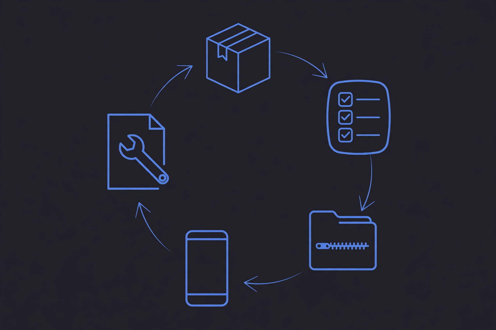
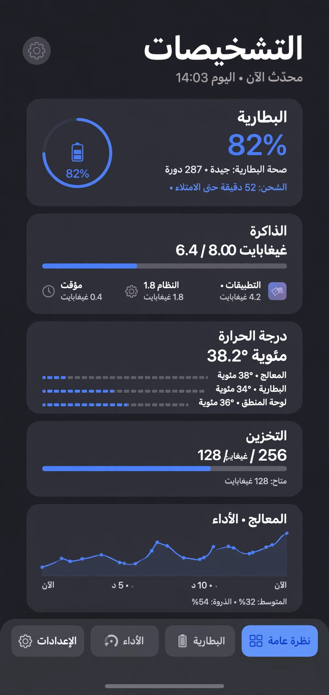
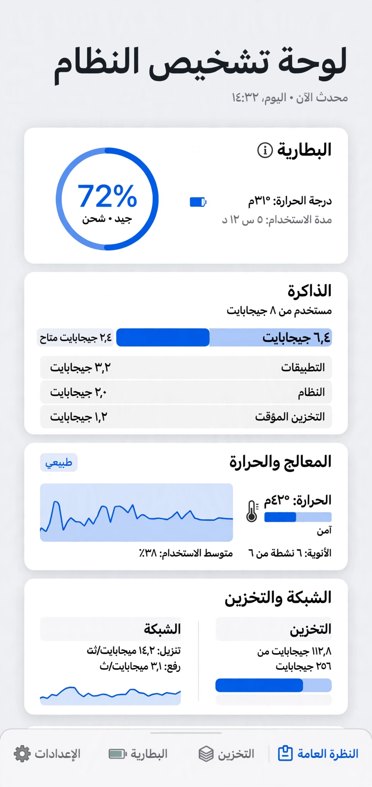

# build-tools


**Build an Android root module for any idea, and know exactly what it did on your phone.**

An AI skill for Magisk, KernelSU, KernelSU-Next, FinaSU and APatch. Every module it builds writes a debug log to `Documents/<id>/` that you send back for fixing, protects itself against bootloops, and reports honest test statuses — never a claim the tools did not print.

Original skill by Laith Harb ([lionlaith7](https://github.com/lionlaith7)), Jordan.

## Install

Works with Claude Code, Codex, Cursor, Windsurf, Gemini/Antigravity, Copilot and every agent that supports skills or rules files. Fastest:

```bash
npx skills add lionlaith7/Claude-Root-Module-Builder
```

Per-agent instructions: [INSTALL.md](INSTALL.md). Agents that read `AGENTS.md` find a pointer at the repo root.

## Use

Ask your agent: "Build a KernelSU module that ...". Install the zip, reboot, then send `Documents/<id>/<id>-debug.log` back.



First time on a new phone: ask for the **canary** module and send its log. It documents what your phone actually supports, so nothing is guessed.

## What you get

- **Debug log in every module.** Spooled in `/data/adb/<id>-logs/` early in boot, copied to `/sdcard/Documents/<id>/<id>-debug.log` when storage is ready. Upload it to your agent to improve the module.
- **Bootloop protection.** A guard disables the module after 3 unfinished boots or 180 s without boot completing — self-disable only, never reboots, never touches other modules. Full playbook in `build-tools/references/bootloop.md`.
- **Honest statuses.** `PASS_STRUCTURAL`, `PASS_SIMULATED`, `PASS_PARTIAL`, `PASS_REAL`, `NOT_TESTED`, `FAIL` — printed by the tools only. `PASS_REAL` requires a log from a real phone whose hashes match the built zip.
- **Live WebUI when you want one.** Self-contained `webroot/index.html`, zero external URLs, sub-second live reads with a file fallback, designed to the unified design system in `build-tools/references/design.md` (FinaSU theme + Apple HIG principles + Material Design 3 anatomy, with hard smoothness budgets).

   
- **Tools.** `new_module.py` (scaffold, `--webui` included), `lint_module.py` (rules LM001–LM040), `build_zip.py` (same input = same zip, plus sha256 manifest), `parse_report.py` (reads the log, prints the status). Templates: `basic`, `service`, `props`, `canary`.

## Also in this repo: skill-router

**[skill-router](skill-router/README.md)** (v1.1.0) — a small meta-skill for agents with large skill catalogs: classify the task, search the catalog, read the best candidates, pick one primary skill (plus at most two supporting ones), and follow them — with precedence rules, anti-patterns, and catalog hygiene. Born after installing 500+ skills and learning that an unrouted catalog is just noise; v1.1.0 adds lessons from a 24h self-test (48 graded routing runs).

```bash
npx skills add lionlaith7/Claude-Root-Module-Builder --skill skill-router
```

## Testing status

Tested offline (structure, lint, deterministic build, dash simulation, `tests/test_all.py`) and **on a real device**: Redmi Note 10 Pro (sweet), Android 16, FinaSU — SysDiag Lab reached `PASS_REAL` on 2026-11-25. Device facts are documented as T3 in `build-tools/references/compat.md`. Other devices still start with the canary.

## Safety

No malware, spyware, keyloggers, credential theft or anti-theft bypass. Keep a rescue path: an empty `disable` file in `/data/adb/modules/<id>/` switches a module off. Never wipe data for a module bootloop.

## What is new

Version 3.9.0: unified design system (`build-tools/references/design.md` — FinaSU theme + Apple HIG principles + Material Design 3 anatomy, with hard speed/smoothness budgets) and nine new patterns from real-device work. Earlier highlights — 3.8: FinaSU `ksu.exec` callback-name rule and `state.json` fallback; 3.4: corrected repo description, this README rewritten for clarity; 3.3: every-agent install (`INSTALL.md`, `AGENTS.md`) and Apple HIG-informed WebUI design; 3.2: first real-device `PASS_REAL`, log-derived fixes, AVC filtering, WebUI lint rules, `--webui` scaffold, test suite; 3.1: bootloop playbook and WebUI rules. Full history: [CHANGELOG.md](CHANGELOG.md). Each update adds 0.1. skill-router is at v1.1.0 (lessons from a 24h self-test).

## Credits and license

See `NOTICE.md` (Magisk installer, GPL-3.0). This repository has no LICENSE file yet.

---

## العربية

مهارة ذكاء اصطناعي تبني مديولات روت لأندرويد (Magisk / KernelSU / KernelSU-Next / FinaSU / APatch) لأي فكرة. كل مديول يكتب سجل أخطاء في `Documents/<id>/<id>-debug.log` لترفعه إلى وكيلك للتحسين، ويحمي نفسه من الـ bootloop، ويعطي حالات اختبار صادقة. فيها أدوات فحص وبناء وتحليل سجل، وقوالب (basic, service, props, canary)، وواجهات WebUI حية بتصميم مستوحى من مبادئ Apple. تم الاختبار على هاتف حقيقي (Redmi Note 10 Pro، FinaSU) ووصلت وحدة SysDiag Lab إلى PASS_REAL. تعمل مع كل الوكلاء (Claude Code, Codex, Cursor, Windsurf, Gemini, Copilot) — راجع `INSTALL.md`. الاسم الصحيح لمجلد المهارة: `build-tools`.

## 中文

这是一个 AI 技能，可为任何想法构建 Android root 模块（Magisk / KernelSU / KernelSU-Next / FinaSU / APatch）。每个模块都会把调试日志写到 `Documents/<id>/<id>-debug.log`，上传给你的代理即可改进；模块带有防启动循环保护，并给出诚实的测试状态。包含检查、打包、日志分析工具，模板（basic、service、props、canary），以及遵循 Apple 设计原则的实时 WebUI。已在真机上测试（Redmi Note 10 Pro、FinaSU），SysDiag Lab 达到了 PASS_REAL。本技能适用于所有 AI 代理（Claude Code、Codex、Cursor、Windsurf、Gemini、Copilot），见 `INSTALL.md`。技能文件夹名必须是 `build-tools`。

